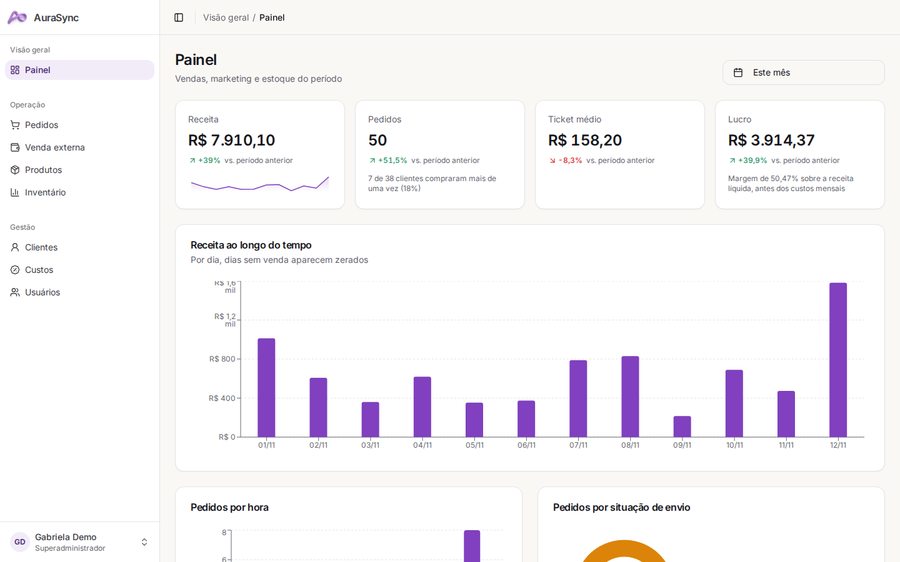
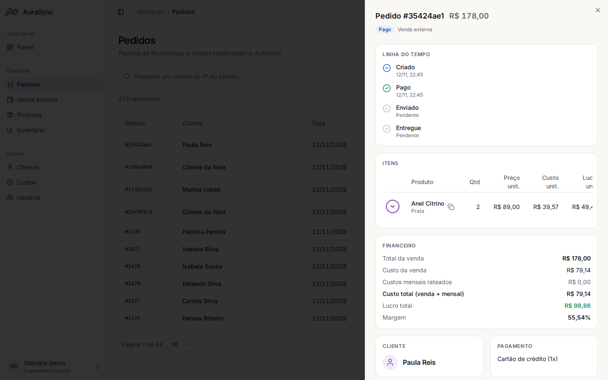
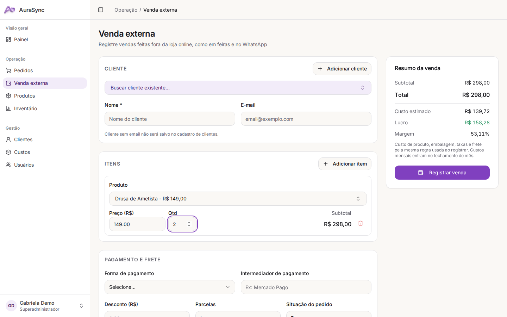
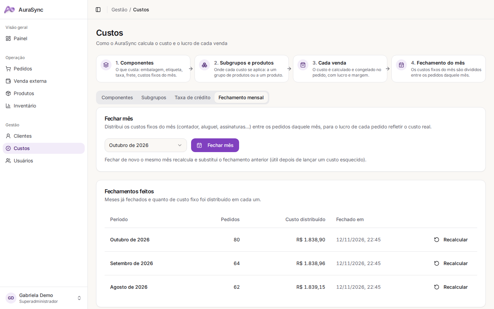
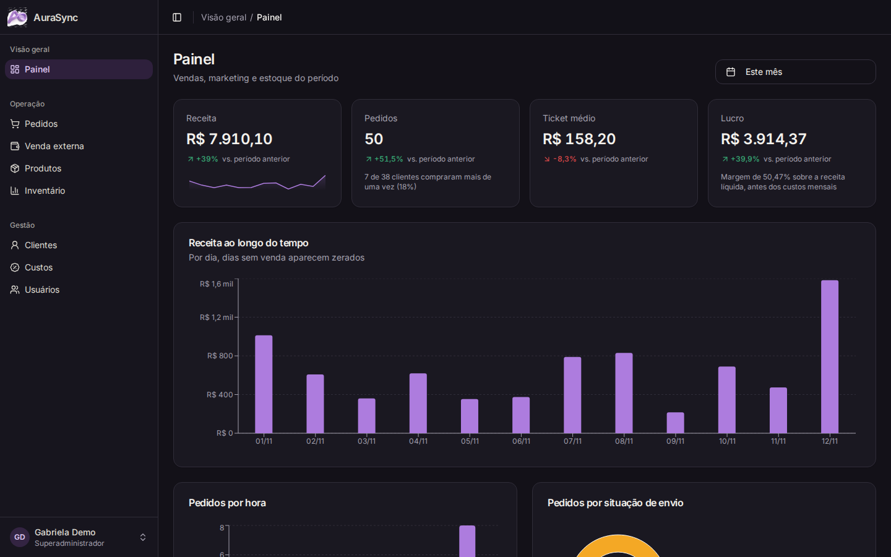
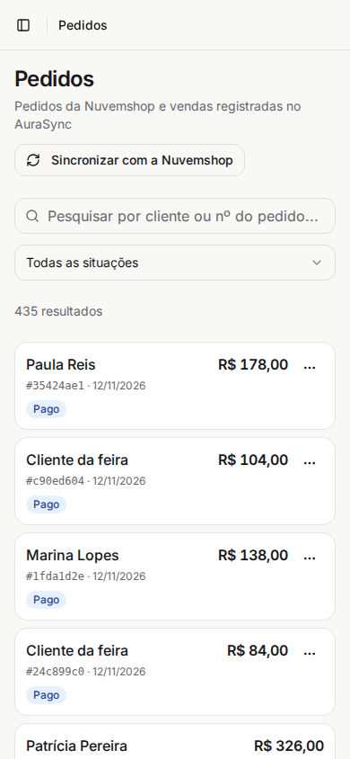
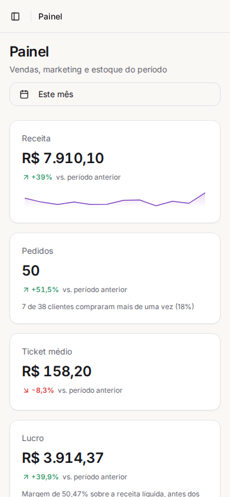

# AuraSync — Painel

Painel de gestão para lojas da **Nuvemshop**: pedidos, estoque, custos e lucro de cada venda, vendas feitas fora da loja (feiras, WhatsApp) e indicadores do período, atualizado em tempo real.

API (back-end): [aurasync-backend](https://github.com/GabGar1/aurasync-backend)



<table>
  <tr>
    <td></td>
    <td></td>
  </tr>
  <tr>
    <td></td>
    <td></td>
  </tr>
</table>

<p align="center">
  
  
</p>

> Os prints usam a loja de demonstração (dados fictícios) gerada pelo `npm run db:seed:demo` da API.

## Funcionalidades

- **Painel**: receita, pedidos, ticket médio e lucro com variação vs. o período anterior; receita por dia (ou semana), horários de pico, situação de envio, marketing (canal, campanha, UTM, estado) e alertas de estoque.
- **Pedidos**: número da Nuvemshop, situação com uma regra única de cores, detalhe com linha do tempo, itens e resumo financeiro; cancelamento devolve o estoque; pedidos da Nuvemshop são só leitura (mudam na própria loja).
- **Venda externa**: registro de vendas fora da loja com **prévia ao vivo** de total, custo e margem, calculada pela API com as mesmas regras da venda.
- **Produtos e inventário**: fotos da Nuvemshop, estoque com alertas (repor, vendido além do estoque), histórico de movimentações com filtros e resumo.
- **Custos**: componentes, subgrupos, taxas de parcelamento e fechamento mensal com histórico.
- **Usuários e sessão**: perfis com matriz de permissões única, troca e redefinição de senha, sessão revogável.

## Arquitetura

```
pages/       telas: compõem componentes e hooks
components/  UI reutilizável (shadcn/ui + StatusBadge, PageHeader, ProductThumb…)
hooks/       comportamento: useDashboard, useSalePreview, useWebSocket, useTableFilters
services/    único lugar que fala com a API (axios + CSRF + tradução de erros)
lib/         regras de apresentação puras e testadas (status, permissões, datas, estoque)
contexts/    sessão (AuthProvider) e conexão em tempo real (RealtimeProvider)
```

- **Uma conexão em tempo real por sessão**: o `RealtimeProvider` mantém um único WebSocket com reconexão exponencial; as telas assinam eventos e invalidam as queries do React Query.
- **Permissões espelhadas da API**: [`lib/permissions.ts`](src/lib/permissions.ts) decide rotas, menu e botões com a mesma matriz que a API aplica.
- **Status com uma regra só**: [`lib/status.ts`](src/lib/status.ts) define cor e rótulo de cada situação; verde, âmbar e vermelho só carregam significado.
- **Design tokens** em [`index.css`](src/index.css) (claro e escuro), primária com contraste AA e fonte Inter servida pelo próprio app.
- **Páginas sob demanda**: cada tela é um chunk; os gráficos só carregam no Painel.

## Rodando localmente

Pré-requisitos: Node 22 e a [API](https://github.com/GabGar1/aurasync-backend) rodando em `http://localhost:3333`.

```bash
cp .env.example .env    # VITE_API_URL=/api usa o proxy do Vite (cookie na mesma origem)
npm ci
npm run dev             # http://localhost:8080
```

Para apontar o painel para outra API (por exemplo, a de demonstração em outra porta): `API_PROXY_TARGET=http://localhost:3401 npm run dev`.

## Qualidade

```bash
npm run check   # lint + typecheck (strict) + testes
npm run build
```

- 127 testes (Vitest + Testing Library) cobrindo regras de status, permissões, sessão, tempo real, prévia da venda e formatação.
- TypeScript `strict`.
- CI no GitHub Actions: lint, typecheck, testes e build de produção.

## Stack

React 18 · TypeScript · Vite · TanStack Query · Tailwind CSS · shadcn/ui (Radix) · Recharts · React Hook Form + Zod · Vitest
